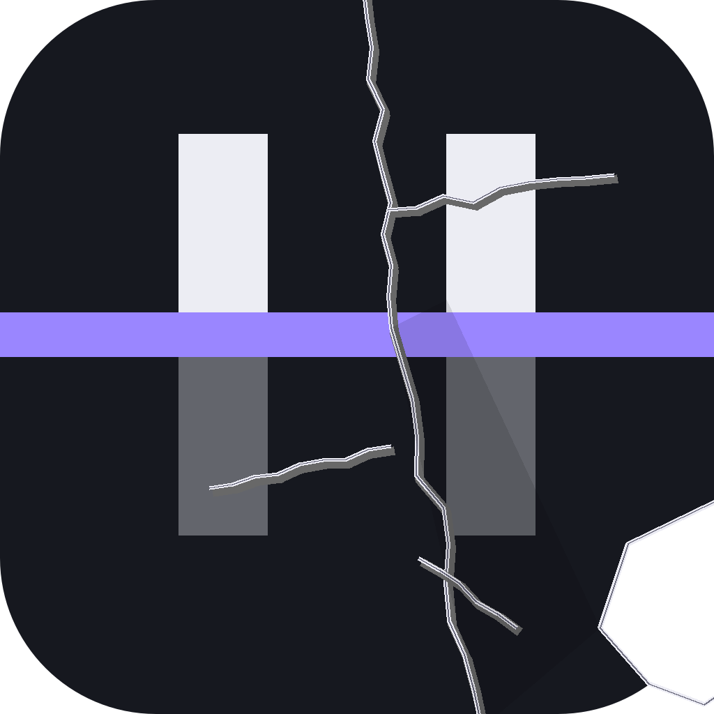

# Offline Patch

A reversible profile patcher for **Horizon** — Minecraft: Java Edition rewritten in Rust. It does
what Project ALM does for Euro Truck Simulator 2 profiles, for Horizon's:

- the **offline player name** (`horizon-player.txt`) the game plays under with no account signed in;
- the **player in a save**: health, hunger, saturation, air, experience level — and the inventory,
  where an item can be put in or taken out, modded ids included.

Every file is copied to the tool's backup folder before it is written, and the Backups page puts any
copy back. A change this tool can't undo is not one it makes.



## What it touches

| File | What changes |
|---|---|
| `<game folder>/horizon-player.txt` | `name:<Player>` — the offline name |
| `<game folder>/saves/<world>/level.dat` | `Data.Player`: `Health`, `foodLevel`, `foodSaturationLevel`, `Air`, `Fire`, `XpLevel`, `XpTotal`, `Inventory` |

Nothing else in the save changes: the NBT reader keeps every tag it doesn't understand, in order.
The launcher's own account check is not bypassed — this tool patches the profile, not Horizon's
sign-in.

## Where its folders are

- Game folders: `HORIZON_HOME`, the launcher's `instances.json` and `settings.json`
  (`minecraft_dir`), `%APPDATA%\.minecraft`, and the folder the tool runs in. **Rescan** looks again.
- Backups: `%APPDATA%\offline-patch\backups` (`OFFLINE_PATCH_HOME` moves it).

## Build

```sh
cargo build --release
cargo test
```

Windows and Linux builds ship from the release workflow; `version.txt` is the only version source.

## License

Unlicense — public domain, no warranty of any kind. See [LICENSE](LICENSE).
